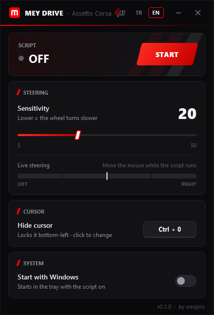

# Mey Drive

**Mouse steering and keyboard pedals for Assetto Corsa. No FreePIE needed.**

[**Download**](../../releases/latest) · [Türkçe](README.md)

Mey Drive turns your mouse into a steering wheel and W / S / C into throttle, brake and clutch, and sends them
straight to vJoy. Steering is slow around the centre and faster towards the ends; the pedals press smoothly. The
loop runs every 5 ms, also while the game is full screen.

- Set the sensitivity with the slider or the mouse wheel; it applies at once.
- **Ctrl + 0** hides the cursor and locks it to the bottom-left corner. Change the shortcut in the app.
- Live steering meter, tray menu and start with Windows.
- Turkish and English: pick **TR / EN** at the top of the window.

## Install

1. Install [vJoy](https://github.com/BrunnerInnovation/vJoy/releases). In *Configure vJoy*, enable device 1 with the X, Y, Z, Rz axes and 8 buttons.
2. Download **MeyDrive.exe** from the [latest release](../../releases/latest) and run it. Nothing else needs to be installed.
3. Press **START**. In Content Manager → Settings → Controls, set the input to *Wheel* and the device to
   *vJoy Device*: steering **X**, throttle **Y**, clutch **Z**, brake **Rz**.

Close FreePIE if it is open; only one program can use vJoy at a time.

| Key | What it does |
|---|---|
| Mouse | steering |
| W / S / C | throttle / brake / clutch |
| B, Left Shift, Left Ctrl, C, Z, Space, E, Q | vJoy buttons 1–8 |
| Ctrl + 0 | hide / show the cursor |

## Questions

<b>Windows says "Windows protected your PC".</b>

The app is not signed with a paid certificate. Choose *More info* and then *Run anyway*.

<b>Is it safe?</b>

The code is all here. Every release is built from it by GitHub Actions, not on a PC, and comes with its SHA-256.

<b>How do I remove it?</b>

Turn off *Start with Windows*, choose *Close* in the tray menu and delete the exe. Settings are in `settings.ini` next to the exe.

## License

[MIT](LICENSE) © weojiro
