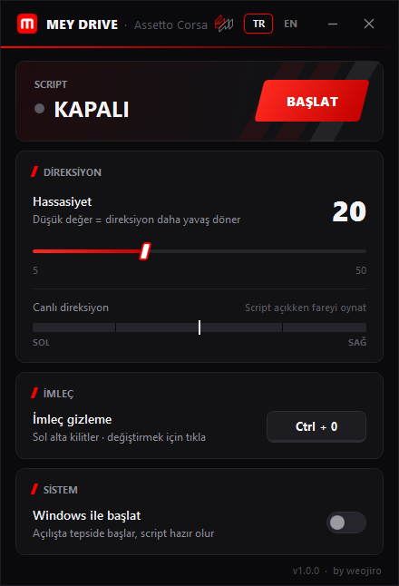

# Mey Drive

**Assetto Corsa için fareyle direksiyon, klavyeyle pedal. FreePIE gerekmez.**

[**İndir**](../../releases/latest) · [English](README.en.md)

Mey Drive fareni direksiyona, W / S / C tuşlarını gaz, fren ve debriyaja çevirip doğrudan vJoy'a gönderir.
Direksiyon ortada yavaş, uçlara doğru hızlı döner; pedallar yumuşak basılır. Döngü sabit 5 ms'dir, oyun
tam ekrandayken de kaymaz.

- Hassasiyeti kaydırıcıyla ya da fare tekeriyle ayarla, anında geçer.
- **Ctrl + 0** imleci gizler ve sol alt köşeye kilitler. Kısayolu uygulamadan değiştirebilirsin.
- Canlı direksiyon göstergesi, tepsi menüsü ve Windows ile başlatma.
- Türkçe ve İngilizce: pencerenin üstündeki **TR / EN** ile seç.

## Kurulum

1. [vJoy](https://github.com/BrunnerInnovation/vJoy/releases)'u kur. *Configure vJoy*'da cihaz 1 açık olsun: X, Y, Z, Rz eksenleri ve 8 buton.
2. [Son sürümden](../../releases/latest) **MeyDrive.exe**'yi indir ve çalıştır. Başka bir şey kurman gerekmez.
3. **BAŞLAT**'a bas. Content Manager → Ayarlar → Kontroller'de girişi *Wheel*, cihazı *vJoy Device* yap:
   direksiyon **X**, gaz **Y**, debriyaj **Z**, fren **Rz**.

FreePIE açıksa kapat; vJoy'u aynı anda tek program kullanabilir.

| Tuş | Ne yapar |
|---|---|
| Fare | direksiyon |
| W / S / C | gaz / fren / debriyaj |
| B, Sol Shift, Sol Ctrl, C, Z, Space, E, Q | vJoy buton 1–8 |
| Ctrl + 0 | imleci gizle / göster |

## Sorular

<b>Windows "Bilgisayarınız korundu" diyor.</b>

Uygulama ücretli bir sertifikayla imzalı değil. *Ek bilgi*'ye, sonra *Yine de çalıştır*'a bas.

<b>Güvenli mi?</b>

Kodun hepsi burada. Her sürüm bir bilgisayarda değil, GitHub Actions'ta bu koddan derlenir ve SHA-256'sıyla gelir.

<b>Nasıl kaldırırım?</b>

*Windows ile başlat*'ı kapat, tepsi menüsünden *Kapat*'ı seç, exe'yi ve `%LOCALAPPDATA%\MeyDrive` klasörünü (ayarlar) sil.

## Lisans

[MIT](LICENSE) © weojiro
